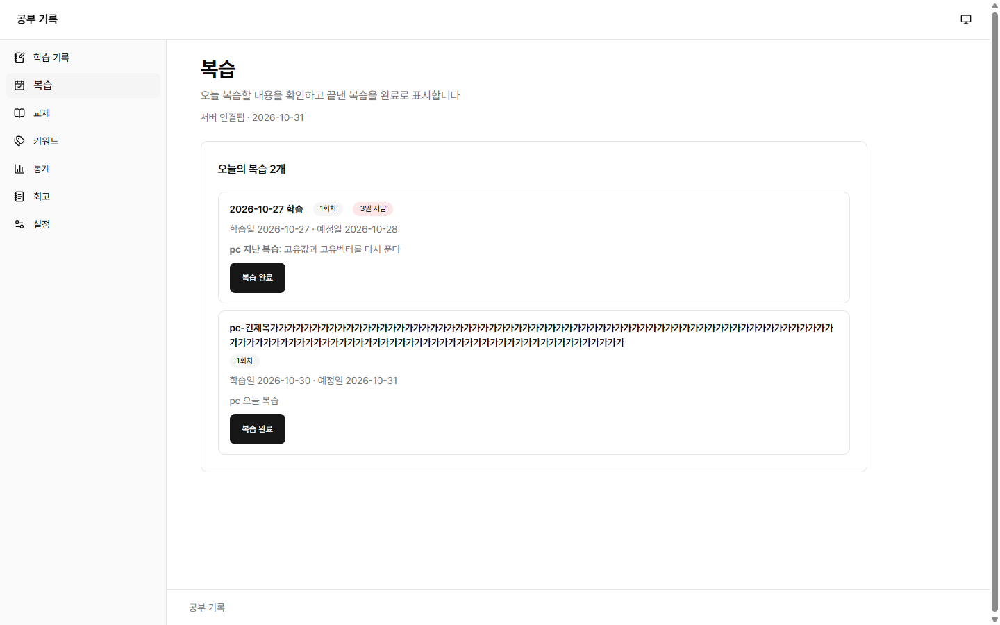
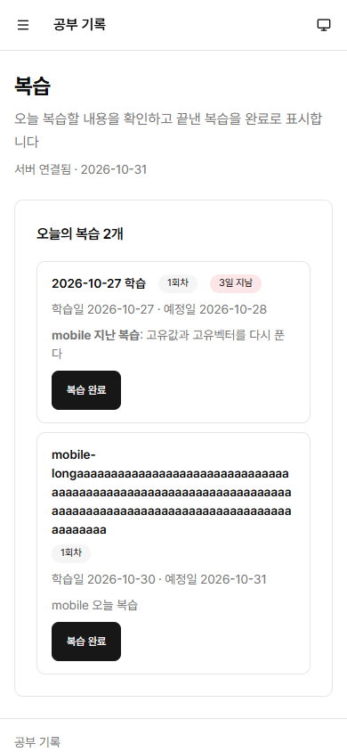

# #43 Today's review list and the completion check

- Issue: [#43](https://github.com/sirloinbh/study-log/issues/43)
- Branch: `feat/43-today-reviews`
- Rules: [review interval rules](../decisions/review-rules.md)

## Purpose

Show what to review today, and keep it in the list until it is completed. When it is completed, create the next round.

## Changes

- `backend/src/reviews.ts`:
  - `GET /api/reviews/today`: returns the incomplete rounds whose due date is today or earlier, oldest first. It also returns today's date (`serviceDate()`).
  - `POST /api/reviews/:id/complete`: completes the round and creates the next round. The due date is the completion date plus the interval of 2, 4, 7, or 16 days. For round 5, there is no next round.
- `frontend/src/reviews.tsx`, `frontend/src/review.ts`: the reviews screen. It shows the round, the days overdue, and the study date and due date.
- `frontend/src/app.tsx`: added "복습" ("Reviews", `/reviews`) to the main menu.

## Decisions

- Completing a round that is already completed answers 409, and a missing one answers 404. By the rules, completion is not undone, so completing again must not change dates.
- Completion is handled at once with no confirmation step. It is a frequent action, and if you pressed it by mistake, you fix the next round's date with the manual adjustment in #45. Until #45, there is no way to fix it. For round 5 there is no next round, so it cannot be fixed even after #45.
- The title of a record with no textbook is "날짜 학습" ("Study on a date"). The note is Markdown, so it is not cut into a title, and it is shown under the title the same way as on the study log screen.
- The completion handling locks the study log row first. It matches the lock order with saving a study log so they do not wait on each other and stall.
- Rounds before their due date do not appear in the list. Completing directly through the API works. The lookup range is handled in #45.

## Tests

- `backend/test/today-reviews.integration.test.ts`: the list range and order, keeping incomplete ones, the dates up to round 5, a late completion, a duplicate completion, keeping round 2 when a record is saved, un-completing and deleting during a lock wait, 404, and 400.
- `frontend/src/reviews.test.tsx`: days overdue, the title rule, a Markdown note, an empty list, completion, the last round, focus on failure, 404 and 409, a failed reload, repeating the same message, a rapid double click, and a load failure.
- `frontend/src/app.test.tsx`: added reviews to the menu and the address.

## Review

In the first review there were no defects in the lock and next-round logic, and I fixed the following in this PR.

- A long title could overflow the card, so I added line wrapping to `.log-date`.
- The note showed as raw Markdown, and for a record with no textbook, the note was not visible from its second line. I show it as `Memo` and changed the title to the date. The title is not cut, so the problem of breaking emoji is gone too.
- If the same completion message repeats, the screen reader does not read it, so I clear the message when a request starts.
- If the button disappears after a failure, focus goes to the title.
- I added tests for the lock wait, keeping round 2, and the frontend failure paths.
- I wrote that a round 5 completion cannot be fixed even after #45.

The second review had nothing to fix. In the review, it was mentioned that checking the long title in Korean could not show the effect of the line wrapping fix, so I checked again with an English title.

CodeQL warned that `GET /api/reviews/today` has no rate limit (`js/missing-rate-limiting`). The user decided to add an Express limit instead of dismissing it as a false positive, so I handled it in [#137](https://github.com/sirloinbh/study-log/issues/137) and merged it into this branch.

## Verification

`npm run check` with `TEST_DATABASE_URL` set passed. After merging `origin/main`, backend 296, frontend 66, and skills 4 passed. The skips were 2 frontend tests, the dark-only app tests that came from the central standards. `npm run standards:check` passed too.

## Browser check

With a dev server connected to the test DB, I checked with headless Chrome at PC (1440×900) and mobile (390×844). I deleted the test data after checking.

- "3일 지남" ("3 days overdue") is shown on a past round, and it stays in the list.
- When completed, it leaves the list, the next review date of today + 2 days is announced, and focus moves to the title.
- When all are completed, "오늘 복습할 내용이 없습니다" ("There is nothing to review today") appears.
- There is no horizontal scroll, and the mobile button height is 44px. A 120-character English textbook title with no spaces also stays inside the card.
- The Markdown in the note is shown in bold.

