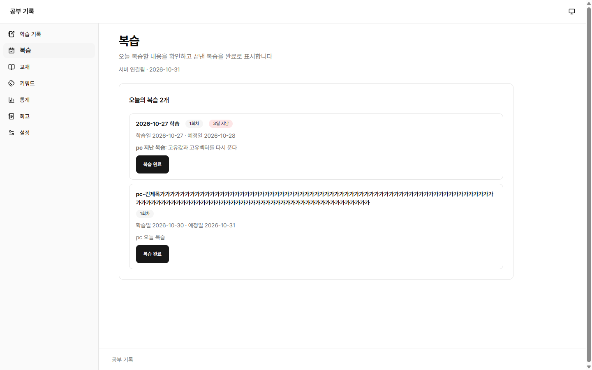
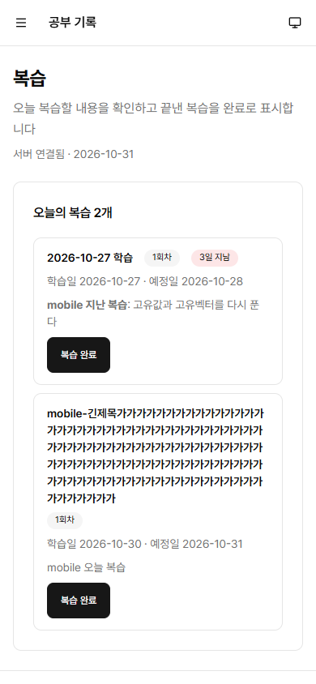

# #43 오늘의 복습 목록과 완료 체크

- 이슈: [#43](https://github.com/sirloinbh/study-log/issues/43)
- 브랜치: `feat/43-today-reviews`
- 규칙: [복습 주기 규칙](../decisions/review-rules.md)

## 목적

오늘 복습할 내용을 보여 주고, 완료할 때까지 목록에 남긴다. 완료하면 다음 회차를 만든다.

## 변경

- `backend/src/reviews.ts`:
  - `GET /api/reviews/today`: 예정일이 오늘이거나 지난 미완료 회차를 오래된 순으로 준다. 오늘 날짜(`serviceDate()`)도 함께 준다.
  - `POST /api/reviews/:id/complete`: 회차를 완료하고 다음 회차를 만든다. 예정일은 완료일에 간격 2·4·7·16일을 더한 날이다. 5회차면 다음 회차가 없다.
- `frontend/src/reviews.tsx`, `frontend/src/review.ts`: 복습 화면. 회차, 지난 일수, 학습일과 예정일을 보여 준다.
- `frontend/src/app.tsx`: 주 메뉴에 "복습"(`/reviews`)을 추가했다.

## 결정한 점

- 이미 완료한 회차를 다시 완료하면 409, 없으면 404로 답한다. 규칙상 완료는 되돌리지 않으므로 재완료로 날짜가 바뀌면 안 된다.
- 완료는 확인 단계 없이 한 번에 처리한다. 자주 쓰는 동작이고, 잘못 눌렀으면 다음 회차 날짜를 #45의 수동 조정으로 고친다. #45 전까지는 고칠 방법이 없다. 5회차는 다음 회차가 없어 #45 뒤에도 고칠 수 없다.
- 교재가 없는 기록의 제목은 "날짜 학습"이다. 메모는 Markdown이라 제목으로 자르지 않고, 학습 기록 화면과 같은 방식으로 제목 아래에 보여 준다.
- 완료 처리는 학습 기록 행을 먼저 잠근다. 학습 기록 저장과 잠금 순서를 맞춰 서로 기다리다 멈추지 않게 한다.
- 예정일 전의 회차는 목록에 나오지 않는다. API로 직접 완료하면 처리된다. 조회 범위는 #45에서 다룬다.

## 테스트

- `backend/test/today-reviews.integration.test.ts`: 목록 범위와 순서, 미완료 유지, 5회차까지의 날짜, 늦은 완료, 중복 완료, 기록 저장 시 2회차 보존, 잠금 대기 중 완료 해제와 삭제, 404, 400.
- `frontend/src/reviews.test.tsx`: 지난 일수, 제목 규칙, Markdown 메모, 빈 목록, 완료, 마지막 회차, 실패 시 포커스, 404·409, 다시 불러오기 실패, 같은 문구 반복, 빠른 두 번 클릭, 불러오기 실패.
- `frontend/src/app.test.tsx`: 메뉴와 주소에 복습을 더했다.

## 리뷰

1차 리뷰에서 잠금과 다음 회차 로직의 결함은 없었고, 다음을 이 PR에서 고쳤다.

- 긴 제목이 카드 밖으로 넘칠 수 있어 `.log-date`에 줄바꿈을 더했다.
- 메모가 Markdown 원문으로 보이고, 교재 없는 기록은 메모 둘째 줄부터 보이지 않았다. `Memo`로 보여 주고 제목은 날짜로 바꿨다. 제목을 자르지 않으므로 이모지가 깨지는 문제도 사라졌다.
- 같은 완료 문구가 반복되면 스크린 리더가 읽지 않아, 요청 시작 때 문구를 지운다.
- 실패 뒤 버튼이 사라지면 포커스가 제목으로 간다.
- 잠금 대기, 2회차 보존, 프런트 실패 경로의 테스트를 더했다.
- 5회차 완료는 #45 뒤에도 고칠 수 없다는 점을 적었다.

## 검증

`TEST_DATABASE_URL`을 설정한 `npm run check`가 통과했다. 백엔드 291건, 프런트 66건, 스킬 4건이 모두 통과했다(건너뜀 0). `npm run standards:check`도 통과했다.

## 브라우저 확인

테스트 DB에 연결한 개발 서버를 headless Chrome으로 PC(1440×900)와 모바일(390×844)에서 확인했다. 확인 뒤 테스트 데이터를 지웠다.

- 지난 회차에 "3일 지남"이 표시되고 목록에 남는다.
- 완료하면 목록에서 빠지고, 오늘 + 2일의 다음 복습 날짜가 안내되며, 포커스가 제목으로 옮겨 간다.
- 모두 완료하면 "오늘 복습할 내용이 없습니다"가 나온다.
- 가로 스크롤이 없고, 모바일 버튼 높이는 44px이다. 공백 없는 120자 교재 제목도 카드 안에 머문다.
- 메모의 Markdown이 굵은 글씨로 표시된다.

