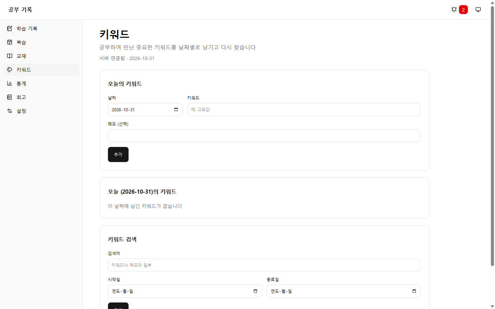
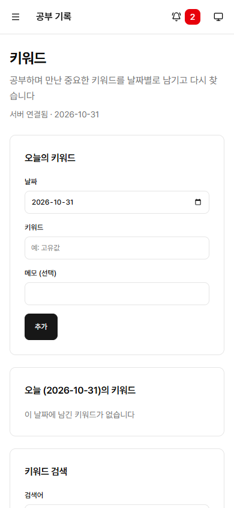

# #44 복습 알림 배지 표시

- 이슈: [#44](https://github.com/sirloinbh/study-log/issues/44)
- 브랜치: `feat/44-review-badge`
- 규칙: [복습 주기 규칙](../decisions/review-rules.md) 2장

## 목적

어느 화면에서든 남은 복습 수를 알 수 있게 한다.

## 변경

- `backend/src/reviews.ts`: `GET /api/reviews/today/count`. 예정일이 오늘이거나 지난 미완료 회차의 수를 준다. 앞으로 예정된 다음 회차는 세지 않는다.
- `frontend/src/review-badge.tsx`: 상단 표시줄의 복습 링크와 개수. 복습이 없으면 보이지 않는다.
- `frontend/src/app.tsx`: 배지를 `AppShell`의 `actions`에 넣었다.
- `frontend/src/reviews.tsx`, `frontend/src/StudyLogs.tsx`: 저장, 삭제, 완료 뒤 `onChange`로 알려 배지가 다시 센다.
- `docs/next-steps/README.md`: 끝난 재부팅과 패키지 설치를 지우고, Docker를 막는 BIOS 설정과 다음 이슈 후보를 현재 상태로 고쳤다.

## 결정한 점

- 이슈의 "내비게이션 배지"를 메뉴 안이 아니라 상단 표시줄에 두었다. 메뉴 항목은 글자만 받는 중앙 관리 파일이고, 모바일에서는 메뉴가 접혀 있어 "어느 화면에서든"이라는 목적에 맞지 않는다.
- 페이지 이동, 저장·삭제·완료, 탭으로 돌아올 때 다시 센다. 탭을 밤새 열어 두어도 돌아오면 맞는 수가 나온다. 주기적으로 묻지는 않는다.
- 개수를 가져오지 못하면 마지막 값을 유지한다. 서버 문제는 각 화면이 알린다.

## 테스트

- `backend/test/review-count.integration.test.ts`: 지난 회차와 오늘 회차만 세기, 미래와 미완료 기록 제외, 완료와 삭제 뒤 감소.
- `frontend/src/review-badge.test.tsx`: 개수와 링크, 0개일 때 숨김, 변경·이동·탭 복귀 시 다시 세기, 실패 시 유지, 늦은 응답 무시.
- `frontend/src/reviews.test.tsx`: 완료 뒤 변경 알림.
- `frontend/src/study-logs-change.test.tsx`: 학습 기록의 저장, 저장 실패, 삭제 뒤 변경 알림.

## 검증

`TEST_DATABASE_URL`을 설정한 `npm run check`가 통과했다. 백엔드 297건, 프런트 80건, 스킬 4건이 통과했다. 건너뜀은 프런트 2건으로, 중앙 표준에서 온 다크 전용 앱 테스트이다. `npm run standards:check`도 통과했다.

## 브라우저 확인

테스트 DB에 연결한 개발 서버를 headless Chrome으로 PC(1440×900)와 모바일(390×844)에서 확인했다. 18개 항목이 통과했고, 확인 뒤 테스트 데이터를 지웠다.

- 다른 화면(키워드)에서도 상단 표시줄에 "오늘 복습 2개"가 보인다. 링크 높이는 44px이고 가로 스크롤은 없다.
- 누르면 복습 화면으로 이동한다.
- 하나를 완료하면 1개로 줄고, 모두 완료하면 사라진다.

학습 기록 화면에서 저장한 뒤 배지가 갱신되는 것은 브라우저에서 확인하지 않았고, 테스트로만 확인했다.

