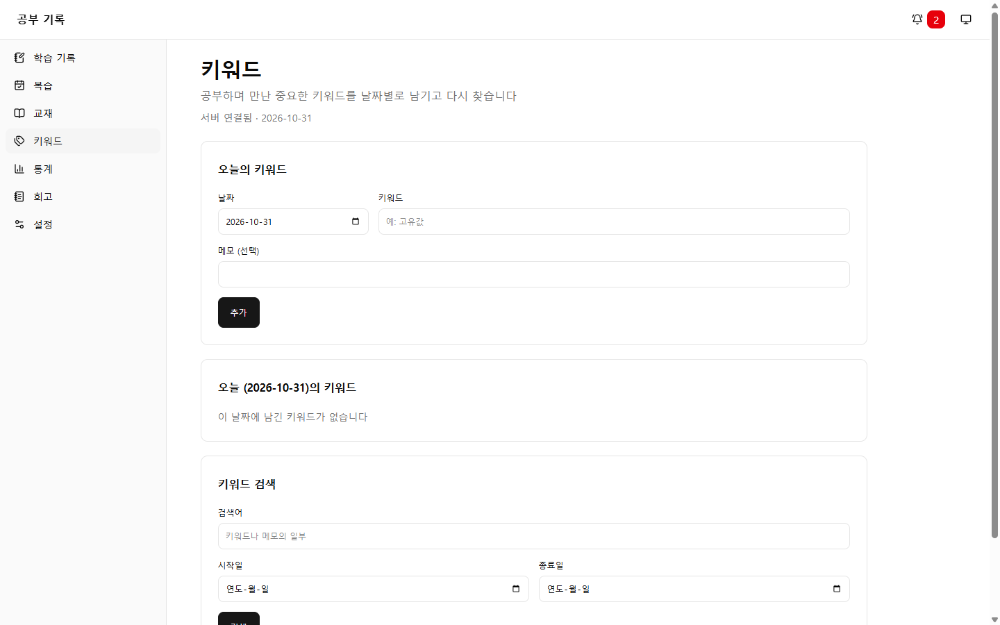
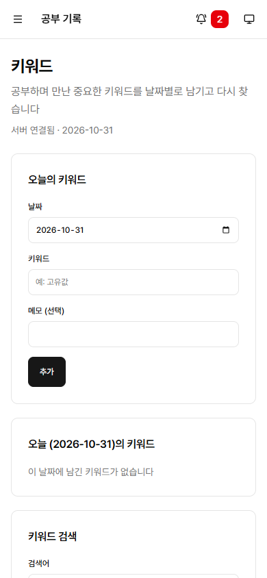

# #44 Show the review notification badge

- Issue: [#44](https://github.com/sirloinbh/study-log/issues/44)
- Branch: `feat/44-review-badge`
- Rules: chapter 2 of the [review interval rules](../decisions/review-rules.md)

## Purpose

Let you see the number of remaining reviews on any screen.

## Changes

- `backend/src/reviews.ts`: `GET /api/reviews/today/count`. It returns the number of incomplete rounds whose due date is today or earlier. Next rounds scheduled for the future are not counted.
- `frontend/src/review-badge.tsx`: the review link and count in the top bar. It is hidden when there are no reviews.
- `frontend/src/app.tsx`: put the badge in the `actions` of `AppShell`.
- `frontend/src/reviews.tsx`, `frontend/src/StudyLogs.tsx`: after save, delete, and complete, notify with `onChange` so the badge counts again.
- `docs/next-steps/README.md`: removed the finished reboot and package install, and fixed the BIOS setting that blocks Docker and the next issue candidates to the current state.

## Decisions

- I put the issue's "navigation badge" in the top bar, not inside the menu. A menu item is a centrally managed file that takes only text, and on mobile the menu is collapsed, so it does not fit the purpose of "on any screen".
- It counts again on page moves, on save, delete, and complete, and when you return to the tab. Even if you leave the tab open overnight, the right number appears when you return. It does not ask periodically.
- If it cannot fetch the count, it keeps the last value. Each screen reports server problems.

## Tests

- `backend/test/review-count.integration.test.ts`: counting only past rounds and today's rounds, excluding the future and incomplete records, and decreasing after completion and deletion.
- `frontend/src/review-badge.test.tsx`: the count and link, hiding at 0, counting again on change, move, and tab return, keeping on failure, and ignoring a late response.
- `frontend/src/reviews.test.tsx`: the change notification after completion.
- `frontend/src/study-logs-change.test.tsx`: the change notification after saving, a save failure, and deleting a study log.

## Review

In the first review there was no problem where counting again resets a form being typed. I fixed the following in this PR.

- The new count test and the statistics test compared whole totals, so they could fail intermittently in a parallel run. I run the two tests in order with a DB lock.
- There was no test for the path that goes through `App` to the badge. `frontend/src/app.test.tsx` checks that the badge changes after save and completion and that the screen is not recreated.
- I added change notification tests for the failure paths (delete 404, complete 409).
- I wrote the finished user steps in `docs/daily/2026-10-31.md`.

The problem that the list on the reviews screen is not refreshed on tab return was split into [#142](https://github.com/sirloinbh/study-log/issues/142).

In the second review, 4 findings came and I fixed them in this PR. The review is limited to 2 rounds, so I did not do a third review.

- If test cleanup failed, the DB lock was not released and `npm test` could hang. I tied cleanup and lock release into one hook, so the lock is released even if cleanup fails.
- The pre-cleanup ran before the lock, so an intermittent failure remained in the run after a forced exit. I moved it after the lock, and the count test also deletes the leftover rows of `0001-01-01` from the statistics test.
- I matched the issues in tomorrow's to-do and the candidates table.
- I added the central standards sync PRs to the daily record.

## Verification

`npm run check` with `TEST_DATABASE_URL` set passed. Backend 297, frontend 83, and skills 4 passed. The skips were 2 frontend tests, the dark-only app tests that came from the central standards. `npm run standards:check` passed too.

## Browser check

With a dev server connected to the test DB, I checked with headless Chrome at PC (1440×900) and mobile (390×844). 18 items passed, and I deleted the test data after checking.

- On another screen (keywords), "오늘 복습 2개" ("2 reviews today") is also shown in the top bar. The link height is 44px and there is no horizontal scroll.
- Pressing it moves to the reviews screen.
- Completing one reduces it to 1, and completing all makes it disappear.

I did not check in a browser that the badge updates after saving on the study log screen, only with `frontend/src/app.test.tsx`.

