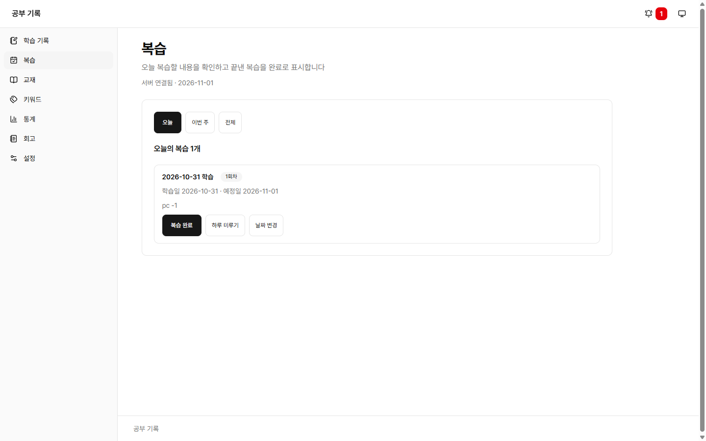
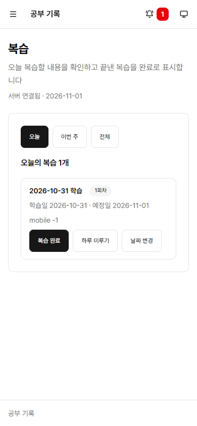

# #45 Review lookup range, manual adjustment, and postponing

- Issue: [#45](https://github.com/sirloinbh/study-log/issues/45)
- Branch: `feat/45-review-adjust`
- Rules: chapter 3 of the [review interval rules](../decisions/review-rules.md)

## Purpose

Manage the review schedule to fit the situation. This also gives a way to fix the next round's date when you pressed review completion by mistake.

## Changes

- `backend/src/reviews.ts`:
  - `GET /api/reviews/week`, `GET /api/reviews/all`: returns up to this week's Saturday, or all incomplete rounds. Past rounds are included.
  - `POST /api/reviews/:id/snooze`: moves it to the day after the later of the due date and today.
  - `PUT /api/reviews/:id/due-date`: changes the due date.
  - Both changes alter only that round's due date and leave the original due date as it is. A completed round answers 409, and a missing round answers 404.
- `backend/src/dates.ts`: moved `isCalendarDate` from `study-logs.ts` and added date addition. This is because the review code importing `study-logs.ts` would create a circular reference.
- `frontend/src/reviews.tsx`, `frontend/src/review.ts`: range buttons (today, this week, all), postponing by one day, and changing the date.

## Decisions

- "All" means all incomplete rounds. It does not show the record of completed rounds. The next round is created when the previous round is completed, so one appears per record in progress.
- The end of this week is Saturday (the week starts on Sunday, #96).
- A manual change allows past dates too. Moving to a past date only makes it show up as an overdue review and has no effect on other behavior.
- You can press "review complete" on a round before its due date too. The next round is set from the real completion date.

## Tests

- `backend/test/reviews.test.ts`: the postponed date, the end of this week.
- `backend/test/review-adjust.integration.test.ts`: lists by range, postponing (a past round, a future round), the next round of a completion after postponing, changing the date in both directions, fixing the next round after a wrong completion, refusing a completed round, 404, and 400.
- `backend/test/review-count.integration.test.ts`: postponing reduces the badge count, and moving to today increases it again.
- `frontend/src/reviews.test.tsx`: switching ranges, ignoring a late response, errors per range, postponing, changing the date, cancel, a rejected date, a case completed elsewhere, retry, and focus.

## Review

In the first review there were no defects in the backend logic, and I fixed the following in this PR.

- The check that compares the badge count exactly ran in parallel with other test files, so it could fail intermittently. I moved it to `backend/test/review-count.integration.test.ts`, which uses a lock.
- Pressing an already selected range button closed the date form being typed. Now it does nothing, and reloads only when the list is in a state where it could not be loaded.
- I added tests for closing the form on a range change and on another review's change, and for locking the range buttons while processing.
- I matched the description text on the reviews screen to the new ranges.

In the second review, the following were fixed in this PR. The review is limited to 2 rounds, so I did not do a third review.

- After a list retry, focus was lost, no signal came when the same error appeared again, and the error of an earlier change remained. When a retry starts, I clear the error, I also clear the earlier error if the date form is not open, and I return focus to the range button.
- When you moved between ranges, a lookup that was in progress could overwrite the list after a completion. Only the response of the most recent lookup is used.
- I fixed the lock release test of the retry and the test location in the change record.

## Verification

`npm run check` with `TEST_DATABASE_URL` set passed. Backend 310, frontend 100, and skills 4 passed. The skips were 2 frontend tests, the dark-only app tests that came from the central standards. `npm run standards:check` passed too.

## Browser check

With a dev server connected to the test DB, I checked with headless Chrome at PC (1440×900) and mobile (390×844). 25 items passed, and I deleted the test data after checking.

- The lists and counts for the today, this week, and all ranges are right. There is no horizontal scroll, and the mobile button height is 44px.
- When you postpone by one day, the new due date is announced, it leaves today's list and the top badge, and focus moves to the title.
- When you change the date, focus goes to the input, a notice appears after saving, and when you move it to today, the badge comes back.

The boundary date of this week was checked with an integration test (based on a Wednesday). The browser check and the captures are based on the final code that includes the second-review fixes. The range button retry was checked only with tests.

